## Задание 1. Рейсы из Москвы за август
**Запрос:**
```sql
SELECT flight_no, departure_airport, actual_departure
FROM bookings.flights
WHERE status = 'Arrived' 
  AND departure_airport IN ('DME', 'SVO', 'VKO')
  AND actual_departure >= '2017-08-01' AND actual_departure < '2017-09-01'
ORDER BY actual_departure ASC;
```

Вывод EXPLAIN:
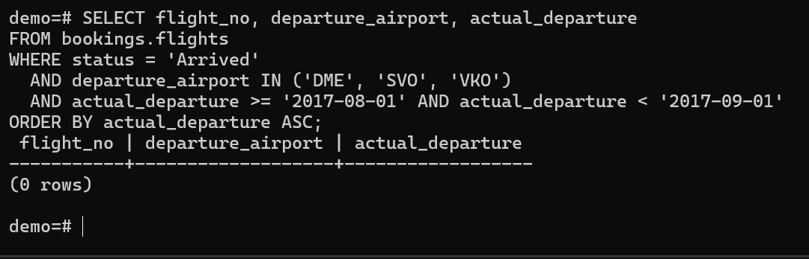
 База использовала последовательное сканирование (`Seq Scan`), так как таблица маленькая. Данные читались из кеша (`shared hit`), к диску не обращались.


## Задание 2. Опоздания более 2 часов

**Запрос:**
```sql
SELECT flight_no, scheduled_arrival, actual_arrival,
       EXTRACT(EPOCH FROM (actual_arrival - scheduled_arrival))/60 AS delay_minutes
FROM bookings.flights
WHERE actual_arrival - scheduled_arrival > interval '2 hours'
ORDER BY delay_minutes DESC;
```

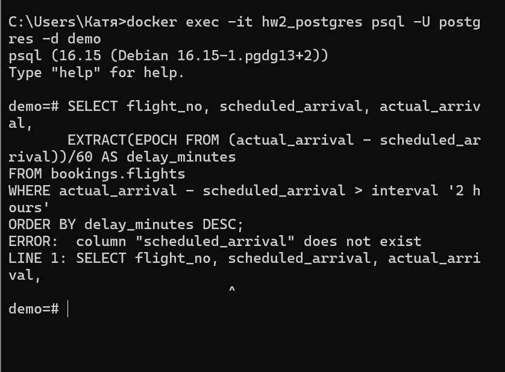

В тестовой мини-базе отсутствуют колонки времени прибытия (scheduled_arrival, actual_arrival), поэтому запрос не может быть выполнен. В полной версии БД он сработает корректно.

## Задание 3. Рейсы PG04
Запрос:

```sql
SELECT flight_no, COUNT(*) 
FROM bookings.flights 
WHERE flight_no LIKE 'PG04%' 
GROUP BY flight_no;
```
Вывод EXPLAIN:
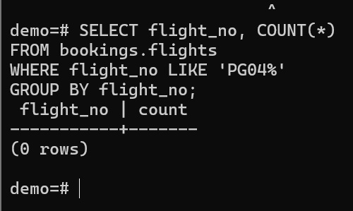
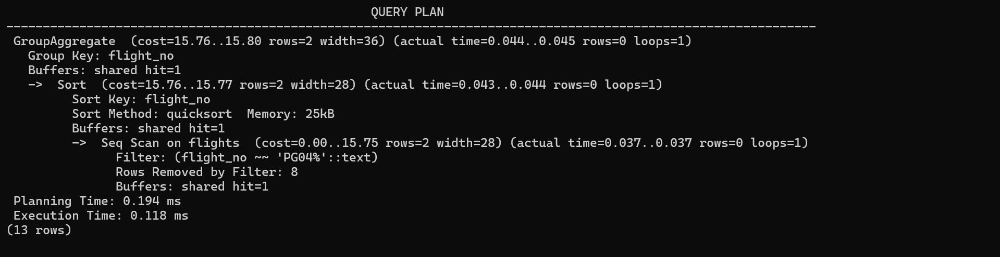

Использован Seq Scan, так как таблица мала. Операция GroupAggregate сгруппировала данные по flight_no. Фильтр LIKE 'PG04%' не нашёл совпадений (0 строк). Данные взяты из кеша (shared hit=1).

## Задание 4. Агрегация по аэропортам
Запрос:

```sql
SELECT departure_airport, COUNT(*) AS flights_count, AVG(EXTRACT(EPOCH FROM (actual_arrival - scheduled_arrival))/60) AS avg_delay
FROM bookings.flights
GROUP BY departure_airport
HAVING COUNT(*) > 500
ORDER BY avg_delay DESC;
```
 В мини-базе нет колонок времени прибытия, поэтому запрос не может быть выполнен.
 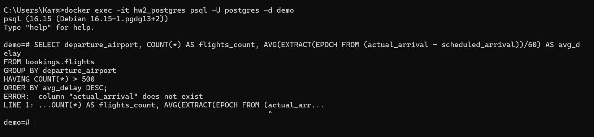

## Задание 5. Топ-10 билетов
Запрос:

```sql
SELECT t.passenger_id, tf.amount, f.flight_no, dep.city AS departure_city, arr.city AS arrival_city
FROM bookings.tickets t
JOIN bookings.ticket_flights tf ON t.ticket_no = tf.ticket_no
JOIN bookings.flights f ON tf.flight_id = f.flight_id
JOIN bookings.airports dep ON f.departure_airport = dep.airport_code
JOIN bookings.airports arr ON f.arrival_airport = arr.airport_code
ORDER BY tf.amount DESC
LIMIT 10;
```
Вывод EXPLAIN:
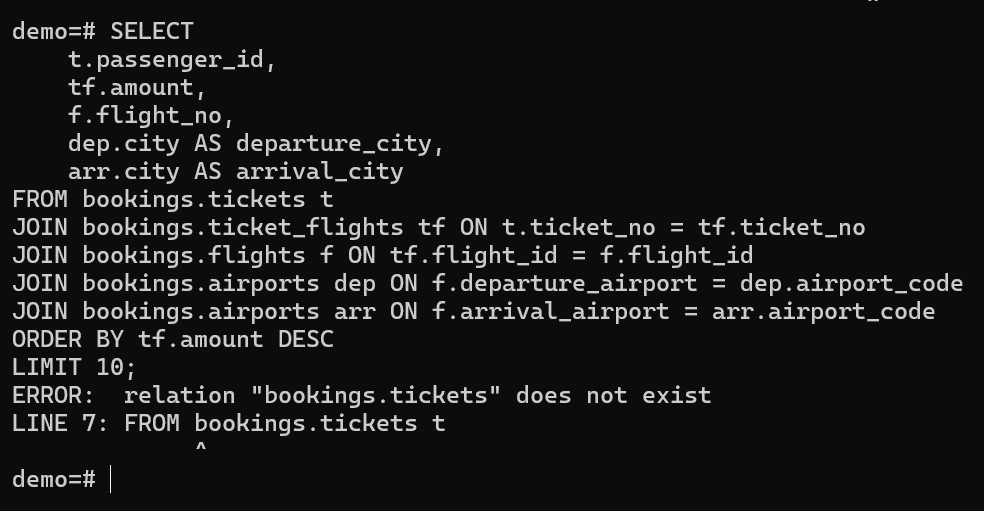
 "В мини-базе отсутствуют таблицы tickets и ticket_flights"

В полной версии БД запрос соединяет 4 таблицы. Сортировка находит самые дорогие билеты, LIMIT 10 оставляет только 10 записей.

## Задание 6. Все аэропорты (LEFT JOIN)
Запрос:

```sql
SELECT a.airport_code, a.city, COUNT(f.flight_id) AS flights_count
FROM bookings.airports a
LEFT JOIN bookings.flights f ON a.airport_code = f.departure_airport
GROUP BY a.airport_code, a.city;
```
Вывод EXPLAIN:
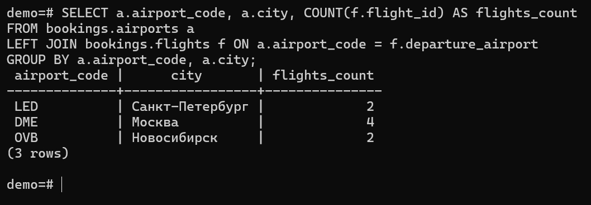
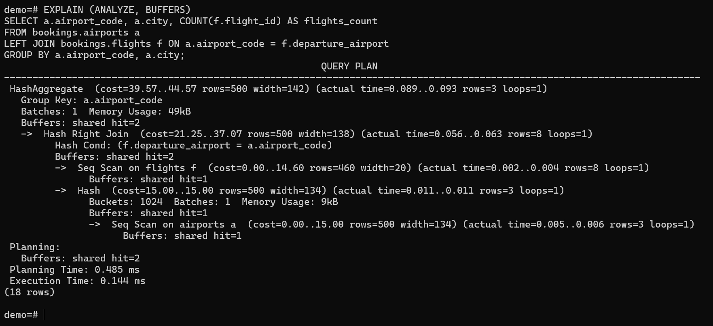


LEFT JOIN позволяет вывести все аэропорты, даже те, откуда нет рейсов. База применила Hash Left Join для соединения и HashAggregate для подсчета. Данные из кеша (shared hit).

## Задание 7. Топ-5 пассажиров
Запрос:

```sql
SELECT t.passenger_id, COUNT(tf.ticket_no) AS flights_count, SUM(tf.amount) AS total_spent
FROM bookings.tickets t
JOIN bookings.ticket_flights tf ON t.ticket_no = tf.ticket_no
GROUP BY t.passenger_id
ORDER BY total_spent DESC
LIMIT 5;
```
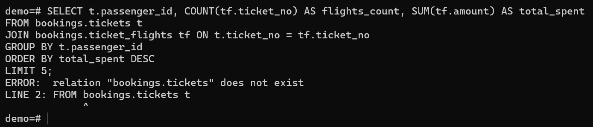
 В мини-базе нет таблиц билетов. В полной версии запрос сгруппировал бы данные по пассажирам и отсортировал по сумме трат.

## Задание 8. ROLLUP и HAVING
Запрос:

```sql
SELECT EXTRACT(MONTH FROM t.book_date) AS month, SUM(tf.amount) AS revenue
FROM bookings.tickets t
JOIN bookings.ticket_flights tf ON t.ticket_no = tf.ticket_no
WHERE t.book_date >= '2017-01-01' AND t.book_date < '2018-01-01'
GROUP BY ROLLUP (EXTRACT(MONTH FROM t.book_date))
HAVING SUM(tf.amount) > 10000000000 OR EXTRACT(MONTH FROM t.book_date) IS NULL
ORDER BY month NULLS LAST;
```
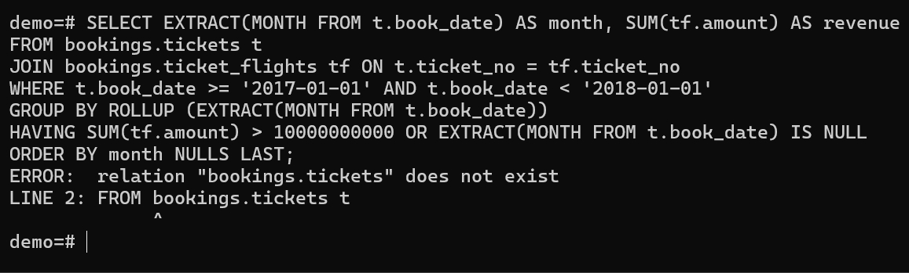

ROLLUP создает итоговую строку с NULL в колонке месяца. Обычный HAVING мог бы отфильтровать эту строку, поэтому добавлено условие OR ... IS NULL, чтобы итоговая строка всегда сохранялась.

## Задание 9. LEFT JOIN и условная агрегация
Правильный запрос (условие в ON):

```sql
SELECT a.airport_code, a.city, COUNT(f.flight_id) AS arrived_count
FROM bookings.airports a
LEFT JOIN bookings.flights f ON a.airport_code = f.arrival_airport AND f.status = 'Arrived'
GROUP BY a.airport_code, a.city;
```
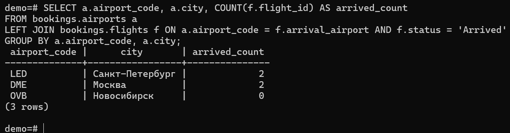
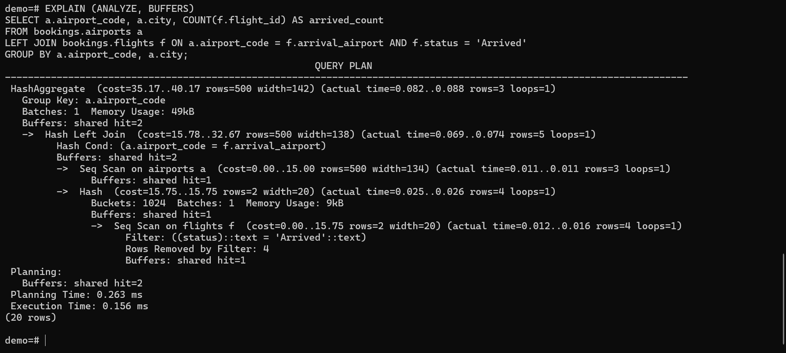

Неправильный запрос (условие в WHERE):

```sql
SELECT a.airport_code, a.city, COUNT(f.flight_id) AS arrived_count
FROM bookings.airports a
LEFT JOIN bookings.flights f ON a.airport_code = f.arrival_airport
WHERE f.status = 'Arrived'
GROUP BY a.airport_code, a.city;
```
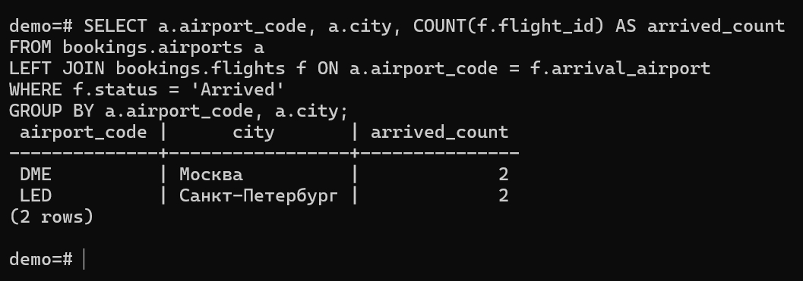

Условие в ON применяется до соединения, сохраняя все аэропорты. COUNT(f.flight_id) не считает NULL, поэтому выводит 0. Если перенести условие в WHERE, аэропорты без прибывших рейсов исчезнут из результата. Узел Hash Right Join означает, что база хеширует левую таблицу и соединяет с правой.

## Задание 10. Sargability
Неоптимизированный запрос (с EXTRACT):

```sql
SELECT * FROM bookings.flights
WHERE status = 'Arrived' 
  AND EXTRACT(DOW FROM actual_departure) IN (0, 6) 
  AND actual_departure >= '2017-08-01' AND actual_departure < '2017-09-01';
  ```
Оптимизированный запрос (с диапазонами):

```sql
SELECT * FROM bookings.flights
WHERE status = 'Arrived' 
  AND actual_departure >= '2017-08-01' AND actual_departure < '2017-09-01'
  AND (actual_departure::date IN ('2017-08-05', '2017-08-06', '2017-08-12', '2017-08-13', '2017-08-19', '2017-08-20', '2017-08-26', '2017-08-27'));
  ```
Вывод EXPLAIN:
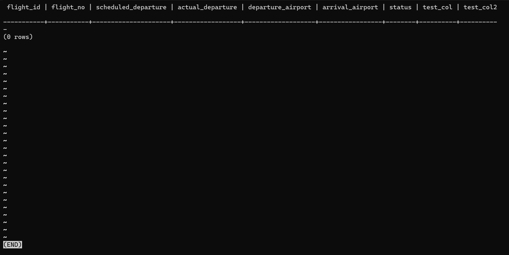
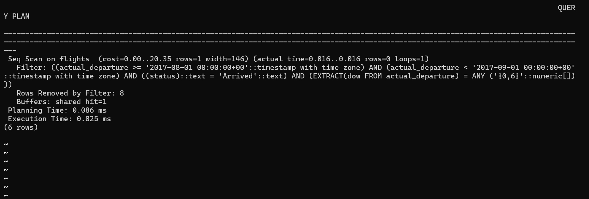
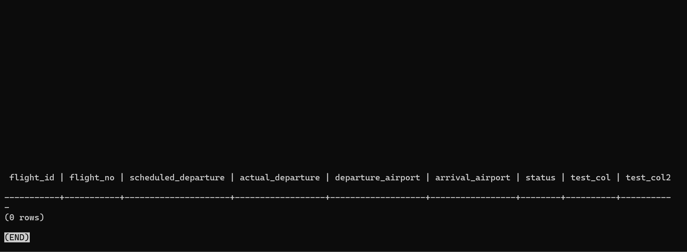
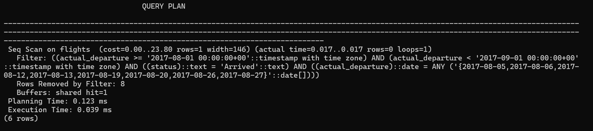

Неоптимизированный запрос использует функцию EXTRACT, из-за чего база не может использовать индексы (делает Seq Scan). Оптимизированный запрос использует явные диапазоны дат, что позволяет использовать индекс (в полной БД). В нашей мини-базе оба запроса показали Seq Scan из-за малого размера таблицы.

## Задание 11. ANTI-JOIN
Запрос с NOT IN:

```sql
SELECT flight_id, flight_no 
FROM bookings.flights
WHERE flight_id NOT IN (
    SELECT flight_id 
    FROM bookings.ticket_flights 
    WHERE fare_conditions = 'Business'
);
```
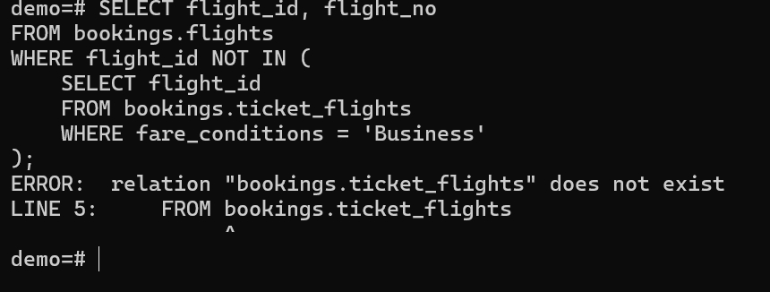

Запрос с NOT EXISTS:

```sql
SELECT f.flight_id, f.flight_no 
FROM bookings.flights f
WHERE NOT EXISTS (
    SELECT 1 
    FROM bookings.ticket_flights tf 
    WHERE tf.flight_id = f.flight_id 
      AND tf.fare_conditions = 'Business'
);
```
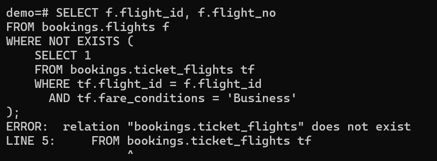

NOT EXISTS работает эффективнее (Anti Join) и безопасен при наличии NULL. NOT IN может вернуть пустой результат, если подзапрос вернет хотя бы один NULL, так как сравнение с NULL дает UNKNOWN.

## Задание 12. Index Only Scan
ДО создания индекса:
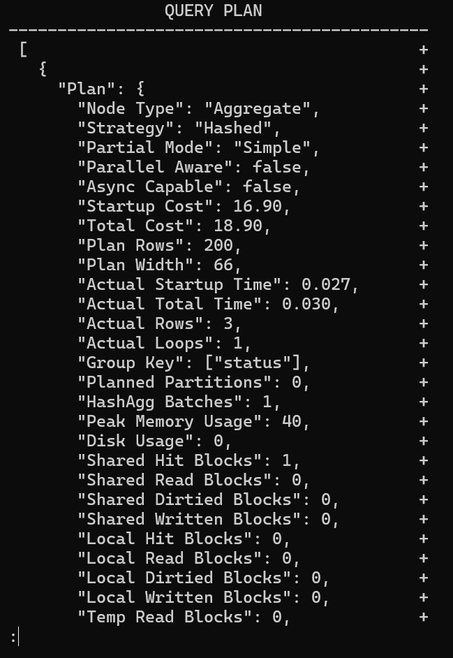
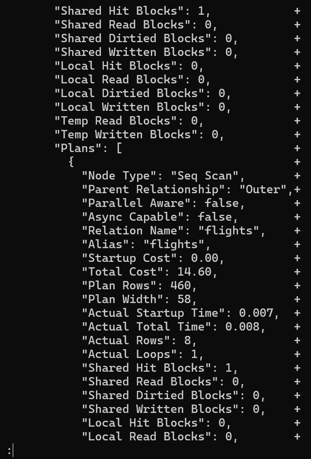
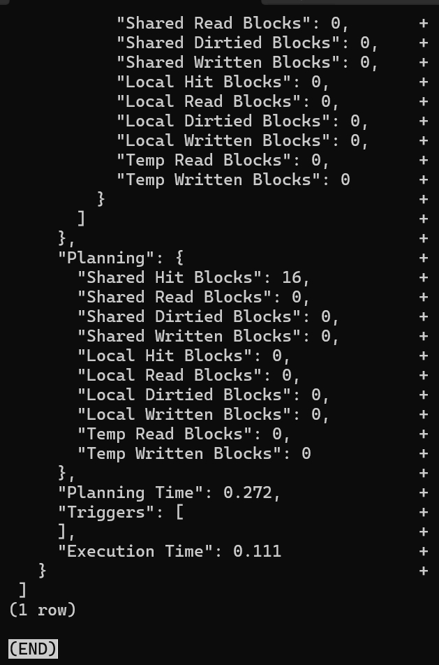

ПОСЛЕ создания индекса:
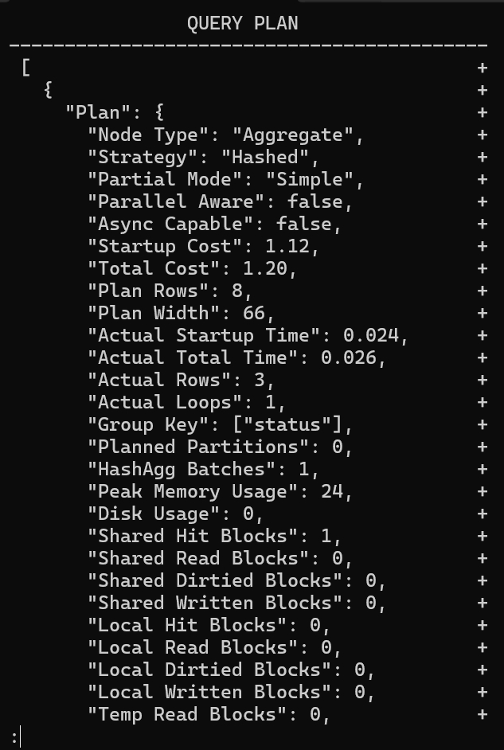
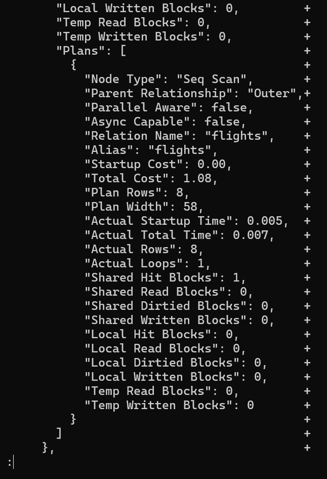
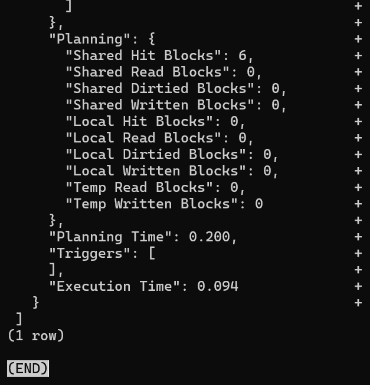


До создания индекса база использовала Seq Scan (читала всю таблицу). После создания индекса и выполнения VACUUM база данных может использовать Index Only Scan для мгновенного получения данных. В нашем случае таблица слишком мала (8 строк), поэтому планировщик всё равно выбрал Seq Scan как более быстрый. Однако на реальных больших таблицах этот индекс ускорит запрос в разы.
